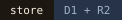
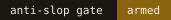
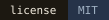
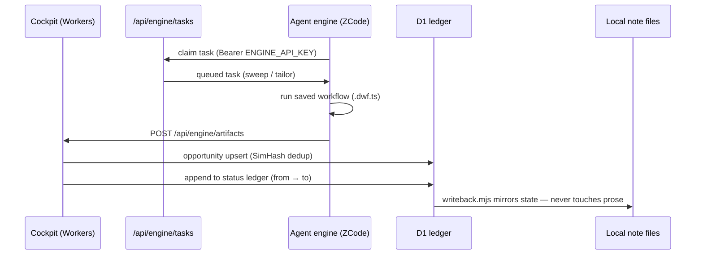
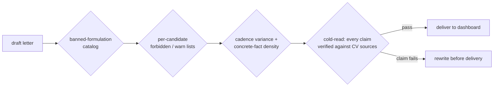

<div align="center">
  <picture>
    <source media="(prefers-color-scheme: dark)" srcset="assets/banner-dark.svg">
    
  </picture>

  <p><sub><b>The cockpit tracks. The agent works. The ledger never lies.</b></sub></p>

  <p>
    
    
    
    
    
  </p>
</div>

A personal **Career Command Center**: a deployed dashboard that tracks every job
application, plus an agent engine that tailors CVs and cover letters, scores fit,
sweeps job boards for new opportunities, and mirrors state back into your local
note files.

Built on Cloudflare's free tier (Workers + D1 + R2) with vinext (Next.js API
surface on Vite). All intelligence runs agent-side on the owner's ZCode plan —
the app itself calls **no paid APIs**.

```
┌─────────────────────────────┐        ┌──────────────────────────────┐
│  Cloudflare app (cockpit)   │  API   │  Agent engine (ZCode)        │
│  ├─ Pipeline kanban         │ ◄────► │  ├─ Opportunity sweep        │
│  ├─ Deadline calendar       │  key   │  ├─ Fit scoring + gap map    │
│  ├─ Document library        │        │  ├─ Cover-letter tailoring   │
│  └─ Funnel stats            │        │  └─ Anti-slop lint gate      │
└─────────────────────────────┘        └──────────────────────────────┘
        D1 (SQLite) + R2 (docs)            dynamic workflows + skills
```

## Components

| Path | What it is |
|---|---|
| `app/` | vinext app: dashboard UI + `/api/engine/*` (Bearer-key task queue, opportunity upsert with SimHash dedup, status ledger, documents, candidates inbox) |
| `engine/` | Agent-side tooling: `lint.mjs` anti-slop gate, `api.mjs` API client, `writeback.mjs` Atlas mirror, `paths.mjs` machine-path resolver, `workflows/*.dwf.ts` saved workflows (`opportunity-sweep`, `tailor-application`) |
| `adapters/` | One-shot importers: reconciliation + commit scripts for bootstrapping from existing tracking files |
| `docs/` | Data model + engine API contract |

## The agent loop



One key protects the queue; the same value logs you into the dashboard. The DB
is the source of truth, the note files are the mirror.

## Anti-slop gate

Generated cover letters pass through a machine-checkable gate before they reach
the dashboard (`engine/lint.mjs`). Four checks, then a cold read:



- banned-formulation catalog (staged importance, not-X-but-Y, inflation words,
  vague authority, assistant residue, filler)
- per-candidate forbidden/warn phrase lists (`cv-facts.json` convention)
- sentence-cadence variance and concrete-fact density checks
- an independent cold-read pass verifies every factual claim against the CV
  sources before delivery

## Quick start

```sh
cd app
npm install
npx wrangler d1 create career-hq-db     # then set the id in cloudflare.config.ts
npx cf d1 migrations apply <db-uuid>    # or: wrangler d1 migrations apply
npm run dev                             # local dev (Miniflare-simulated D1)
npm run deploy                          # workers.dev deployment
```

**Secrets:** `ENGINE_API_KEY` (Worker secret) protects `/api/engine/*`; the same
value is the dashboard login key. Store it in `engine/.engine-env` (gitignored)
for the engine and `.dev.vars` for local dev. Copy `engine/paths.example.json`
to `engine/.paths.json` and point it at your own CV/notes files.

## Status ledger convention

`status_log` follows the append-only transition-ledger pattern
(`from → to`, `-` sentinel for unknown states, closed source vocabulary).
The dashboard DB is the source of truth; `engine/writeback.mjs` mirrors
status changes into local note files without ever editing their prose.

## License

MIT
